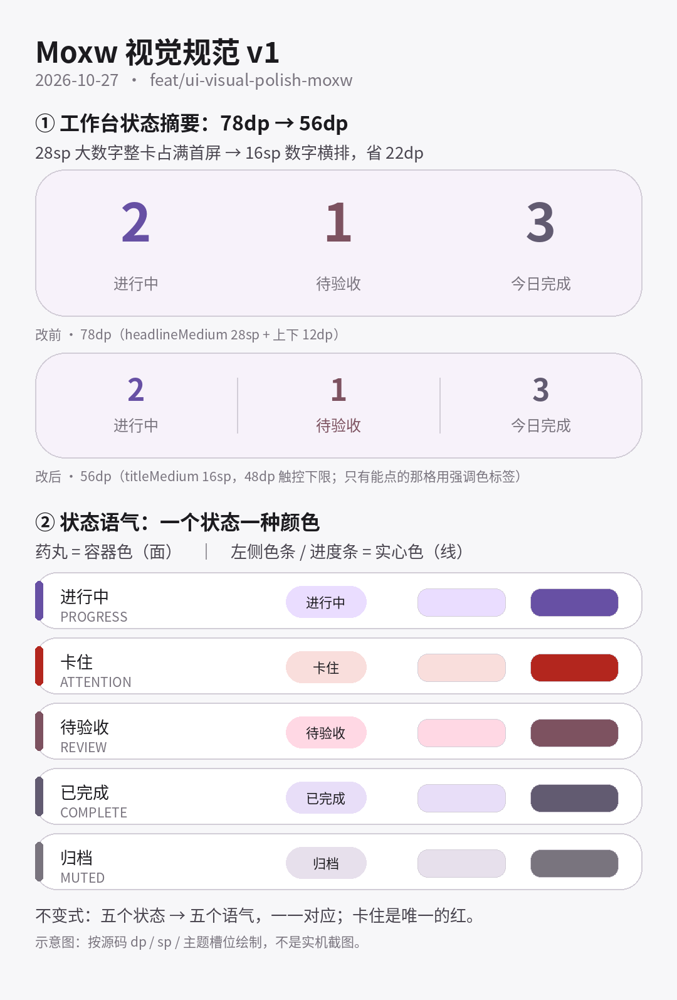

# Moxw 客户端成套视觉规范 v1（2026-10-27）

分支 `feat/ui-visual-polish-moxw`，基线 `origin/moxw` @ `357ee5c78`（PR #435 合并后的交互修复）。
本轮只做**视觉**：间距 / 圆角 / 表面层级 / 字阶 / 状态色语义。不改交互流程，不回退上一轮五项交互修复。

---

## 0. 一句话方向

**低噪声、单色主结构、状态靠一种颜色说话、层级靠间距和字重而不是边框和阴影。**

拆成 4 个关键词：

| 关键词 | 含义 | 反面（改动前） |
|---|---|---|
| 安静的表面 | 卡片用 `surfaceContainerLow` + 极淡描边分层 | 全靠 `tonalElevation = 1.dp`：浅色主题看不见，深色主题像灰雾 |
| 有节奏的间距 | 组内 8dp、组间 20dp | 全屏统一 8dp，标题和卡片糊成一片等距列表 |
| 唯一的状态色 | 一个状态 → 一种语气 → 一种颜色 | 运行中(主色) + 待验收(三色) + 已完成(二色，常为灰绿) 语义打架 |
| 只给该重的东西重量 | 首屏只留一个视觉焦点 | 28sp 大数字统计卡抢走任务列表的注意力 |



> 上面这张是按源码 dp / sp / 主题槽位绘制的**规范示意图**（脚本 `out/make_visual_spec.py`），不是实机截图。

---

## 1. 视觉基元（tokens）

新文件：`app/src/main/java/me/rerere/rikkahub/ui/theme/UiVisual.kt`

### 1.1 间距 `Spacing`

| token | 值 | 用途 |
|---|---|---|
| `xxs` | 2dp | 图标与文字贴边 |
| `xs` | 4dp | 同行元素间距、行内小分隔 |
| `sm` | 8dp | 卡片内行距、列表项间距 |
| `md` | 12dp | 紧凑卡片内边距 |
| `lg` | 16dp | 标准卡片内边距、页面左右留白 |
| `xl` | 24dp | 空态、弹层呼吸 |
| `sectionGap` | 20dp | **组间距**，必须 > `sm`，否则分组读不出来 |

规则：新代码禁止写裸 `dp` 值做间距；只有图标尺寸（如 16/18/64dp）与描边（1dp）允许裸值。

### 1.2 圆角 `Radius`

| token | 值 | 用途 |
|---|---|---|
| `chip` | 8dp | 小标签、内嵌块、可点文字行 |
| `card` | 16dp | 卡片 / Hero / 统计条 |
| `sheet` | 24dp | 底部弹层 |

规则：一屏内不超过两档圆角（`card` + `chip`）。禁止再出现 12/14/18/20 这类“差不多”的圆角。

### 1.3 线条 `Hairline`

| token | 值 | 用途 |
|---|---|---|
| `BORDER_ALPHA` | 0.45 | 卡片描边（叠 `outlineVariant`） |
| `DIVIDER_ALPHA` | 0.6 | 分隔线（叠 `outlineVariant`） |

全部是 alpha，不是颜色 —— 深浅主题、动态取色、用户自定义主题都自动适配。**本规范不新增任何硬编码色**（`Color(0x…)`）。

### 1.4 组件 `GroupCard` / `SectionHeader`

```kotlin
// 统一卡片：surfaceContainerLow + 1dp outlineVariant(0.45) 描边，无阴影
GroupCard(modifier = Modifier.fillMaxWidth()) { … }

// 可点卡片：同一外观，走 Surface(onClick) 的水波纹
GroupCard(onClick = { … }) { … }

// 组标题：titleSmall + onSurfaceVariant；topGap 默认 12dp，组间用 Spacing.sectionGap
SectionHeader(title = "进行中", topGap = Spacing.sectionGap)
```

字阶对照（本规范里唯一允许的三档“文字重量”）：

| 角色 | 样式 | 颜色 |
|---|---|---|
| 组标题 | `titleSmall` (14sp/500) | `onSurfaceVariant` |
| 卡片标题 | `titleSmall` (14sp/500) | `onSurface` |
| 正文 / 描述 | `bodyMedium` (14sp/400) | `onSurfaceVariant` |
| 辅助信息（计数、时间） | `labelSmall` (11sp/500) | `onSurfaceVariant` |

组标题与卡片标题**同字号、只差颜色**：这是刻意的 —— 层级靠位置和色调，不靠再堆一级字号。

---

## 2. 状态色语义（本轮核心）

新文件：`app/src/main/java/me/rerere/rikkahub/ui/pages/workbench/MissionStatusTone.kt`

拆两层：`MissionStatus → MissionStatusTone`（纯函数，可单测）→ 颜色（一个地方映射到主题色）。

| 状态 | 语气 | 药丸（container / content） | 实心 accent（色条、进度条） |
|---|---|---|---|
| ACTIVE 进行中 | `PROGRESS` | `primaryContainer` / `onPrimaryContainer` | `primary` |
| BLOCKED 卡住 | `ATTENTION` | `errorContainer` / `onErrorContainer` | `error` |
| REVIEW 待验收 | `REVIEW` | `tertiaryContainer` / `onTertiaryContainer` | `tertiary` |
| DONE 已完成 | `COMPLETE` | `secondaryContainer` / `onSecondaryContainer` | `secondary` |
| ARCHIVED 归档 | `MUTED` | `surfaceVariant` / `onSurfaceVariant` | `outline` |

不变式（`MissionStatusToneTest` 守护）：

1. 五个状态 → 五个语气，**一一对应**，不存在两个状态共用一个颜色。
2. `BLOCKED` 是**唯一**的 `ATTENTION` —— 一屏里只允许一处红。
3. 容器色只用于“面”（药丸底），实心 accent 才用于“线”（左侧色条、进度条）。原因：容器色是低饱和浅色，画 3~4dp 的细线在浅色主题下几乎和轨道同亮度，等于没画。

---

## 3. 落地清单（问题 → 改法 → 证据）

> 说明：本轮**没有实机截图**。设备处于锁屏 + 通知栏展开状态，且 `take_screenshot` 在本会话无授权通道（`tool_not_authorized`）。因此前后对比一律用**源码尺寸证据**（dp / sp / 颜色 token），不冒充截图。

### 3.1 工作台（`WorkbenchContent.kt` / `WorkbenchComponents.kt`）

| # | 问题（改前） | 改法（改后） | 证据 |
|---|---|---|---|
| W1 | Hero 统计卡用 `headlineMedium`(28sp) 大数字，整卡高约 78dp，占满首屏第一屏，把任务列表挤下去 | 新 `StatStrip`：`titleMedium`(16sp) 数字 + `labelSmall` 标签，一格高 ~56dp（含 48dp 触控下限），整卡省约 22dp | `StatBlock` 24+36+2+16 ≈ 78dp → `StatCell` 16+24+16 = 56dp |
| W2 | 三个数字分别染色 primary/secondary/tertiary，像装饰霓虹，且与卡片状态色语义打架 | 数字仍带语气色，但**只有真能点的那一格**（待验收）标签也用强调色；不可点时回归中性灰 —— 视觉上区分“信息”与“动作” | `StatCell(onClick = null → label = onSurfaceVariant)` |
| W3 | 「待验收」格 `clickable(enabled = 条数>0)`：0 条时不可点，但外观与可点时完全一致（假可点） | 可点性由 `onOpenReview: (() -> Unit)?` 表达，外观随之变化；触控高度 `heightIn(min = 48.dp)` | `StatStrip(onOpenReview = if (reviewTarget != null) … else null)` |
| W4 | 全屏统一 `spacedBy(8.dp)`：组标题、卡片、下一组之间距离一样，读不出分组 | 组间 `SectionHeader(topGap = Spacing.sectionGap=20dp)`，组内仍 8dp | 4 处组标题全部换成 `SectionHeader` |
| W5 | 任务卡左边 4dp 色条用容器色（浅色主题几乎不可见），进度条同色 → 进度看不出来 | 色条 3dp + 实心 `accent`；进度条 `accent`；卡片改 `GroupCard` | `missionStatusAccent()`；`LinearProgressIndicator(color = accent)` |
| W6 | 进度比例 `checked/criteria`：理论上除零 → NaN → 画成满格（看着像“全通过”） | `MissionProgress.fraction()` 返回 `Float?`，无验收项时不画进度条 | `MissionStatusToneTest#progress fraction is null…` |
| W7 | 一条任务都没有时，空态上方还摆着「0 / 0 / 0」三个大数字 | 三项全为 0 时整条不渲染，只留空态 | `if (activeMissions.isNotEmpty() \|\| reviewMissions.isNotEmpty() \|\| doneToday > 0)` |

### 3.2 任务详情（`MissionDetailPage.kt`）

| # | 问题 | 改法 | 证据 |
|---|---|---|---|
| D1 | Hero 卡只有标题 + 状态，要往下滚到第二张卡才知道验收进度 | 标题下方加一行 4dp 进度条 + `X/Y` 计数（仅在存在验收项时） | `heroProgress != null` 分支 |
| D2 | 「绑定对话」是图标 + 主色文字，长得像链接但**点了没反应** | 给行为：`clickable` + 跳 `Screen.Chat(id = conversationId)`，圆角 `Radius.chip`，触控加 4dp 竖向内边距 | `navController.navigate(Screen.Chat(id = boundConversationId))` |
| D3 | Hero 与验收卡各自 `Surface(16.dp, tonalElevation=1)`，与工作台卡片不是同一种表面 | 统一 `GroupCard` + `Spacing` | 两处 `Surface(...)` → `GroupCard` |
| D4 | 「产出」「时间线」是裸 `titleSmall` 文本标题，和卡片标题同重量，层级打平 | 换 `SectionHeader(topGap = Spacing.md)`（= 12dp + LazyColumn 的 12dp = 24dp 组间隔） | 2 处 |

### 3.3 主聊天 / 抽屉（`ChatPage.kt` / `ChatDrawer.kt`）

| # | 问题 | 改法 | 证据 |
|---|---|---|---|
| C1 | 顶栏副标题 `fontSize = 8.sp`（Material 最小档 labelSmall 是 11sp），任何字号下都读不出来 | `fontSize = 11.sp` + `lineHeight = 12.sp`（行高压住，顶栏高度不变） | `ChatPage.kt:965` |
| C2 | 抽屉底部：助手选择卡与 5 个全局入口之间没有任何分隔，糊成同一排按钮 | 中间加 `DrawerHairline`（两端渐隐发丝线） | `ChatDrawer.kt:464` |

### 3.4 明确**没做**的（避免无证据换肤）

- `ChatInput` 的玻璃胶囊（16↔28dp 圆角动画、`hikkaGlassStyle`）：这是产品识别度最高的一块，且有自己的材质语言，本轮不动。
- 消息气泡、Markdown/代码块排版：改动面大、缺实机对照，留到有截图条件时再做。
- 设置页 / 扩展页：非高频入口，不做无证据统一。
- 抽屉 dock 的圆形入口尺寸/材质：上一轮刚改过（图标+文字），本轮只加分隔线。

---

## 4. 可访问性与适配

- **触控**：`StatCell` 加 `heightIn(min = 48.dp)`；「绑定对话」改成链接后加 `heightIn(min = 48.dp)`（原来只有约 20dp 高，点不中）。
- **大字体**：所有新增文字用主题字阶（`titleMedium`/`labelSmall`），不写死 sp；`StatCell` 说明文字 `maxLines=1 + Ellipsis`，字体放大时不撑破卡片。
- **深浅主题**：新增颜色全部来自 `MaterialTheme.colorScheme`，alpha 只作用于 `outlineVariant`；无 `Color(0x…)` 新增（可用 `git diff | grep Color\(0x` 复核，结果为空）。
- **动态取色 / 自定义主题**：`GroupCard` 用 `surfaceContainerLow`、状态语气映射到 `primary/error/tertiary/secondary/outline`，均为主题槽位，不改写 `colorScheme`。
- **中文文案**：未新增用户可见字符串（全部复用既有 `R.string`），无新增英文资源。
- **contentDescription**：`StatStrip` 由两个 `Text` 组成，TalkBack 读作「1 待验收」；`clickable` 已带点击语义。未额外添加 `role`，见验证报告 R4。

---

## 5. 复核方法（给下一位）

```bash
# 1) 只在 diff 里查“违规色 / 违规字号”
git diff | grep -E "^\+" | grep -E "Color\(0x|\.sp\b"

# 2) 括号平衡（上一轮吃过 CreateMissionSheet 漏右括号的亏）
#    注意：MissionDetailPage.kt 原本 paren 就 +2（字符串内的括号），比对 HEAD 才准确
git show HEAD:<file> > /tmp/orig.kt && python3 - <<'EOF'
import re
for p in ("/tmp/orig.kt", "<file>"):
    t = open(p).read()
    t = re.sub(r'//[^\n]*', '', t); t = re.sub(r'/\*.*?\*/', '', t, flags=re.S)
    t = re.sub(r'"(?:\\.|[^"\\])*"', '""', t)
    print(p, "paren", t.count('(')-t.count(')'), "brace", t.count('{')-t.count('}'))
EOF

# 3) 语法（注意大小写不敏感 + 反向验证检查器敏感性）
/workspace/bin/kcheck <files…>            # 只保留语法级错误

# 4) 纯逻辑单测（本机可跑，无 Compose 依赖）
#    MissionStatusToneTest 的断言可以在本机用 kotlinc + stub enum 跑通，见验证报告
```
